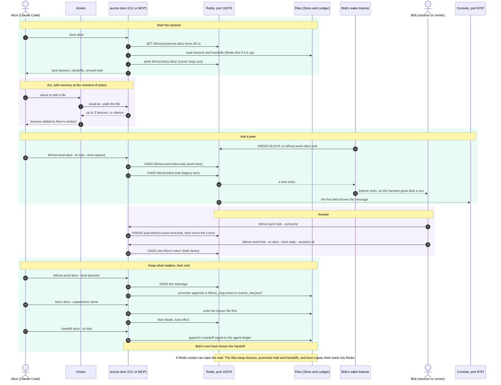

Aurora is shared memory, a message bus and a trust layer for a team of AI agents and one human. What one agent learns reaches the next agent at the moment it acts.

Many agent tools bet on parallel work: spin up throwaway workers, then forget them. Aurora bets on accumulation. Its agents are long-lived peers on a shared bus. A lesson one agent pays for shows up for the next agent that stands in the same place. The house rule behind it fits in one line: **the model proposes, the environment decides.**

This tutorial walks you through that idea in four parts. You play every agent yourself, in a sandbox, so nothing reaches the real shared memory.

## The pieces you will touch

Aurora is built in layers on one record that is never rewritten.

| Layer | What it does | Where you meet it |
|---|---|---|
| Foundation | The Store holds what is true now, by key. The Ledger holds what happened, in order. Both write files first and use Redis to go fast. | Every part |
| Bifrost bus | Live mail between running agents, on Redis Streams. Each agent has its own inbox and bookmark. The bus is disposable on purpose. | Part 2 |
| Knowledge | Lessons, recall, and recall at the moment of action. | Part 1 |
| Coordination | Locks, handoffs and the task ledger, so agents work side by side without colliding. | Part 3 |
| Doors | The shell CLI, MCP tools and the runner toolbox. Three ways into one memory. | Every part |
| Trust and fleet | Who may write, and which agents are alive right now. | Part 4 |

You need no Redis server. If none runs, Aurora starts a small embedded one on port 16379 and saves it to SQLite. If Redis goes down anyway, the files still hold everything that must last.

## How the bus and Redis fit with everything

This diagram follows two agents through one working session. Alice works in Claude Code. Bob is another agent, such as a second session or an API model run by a [runner](/docs/concepts/bifrost/runners). Each arrow is one real call. The parts of the tutorial take these steps one at a time.



Three things in it are easy to miss:

- **Two homes for one message.** The bus keeps mail in Redis only. The [promoter](/docs/concepts/bifrost/promoter) copies four kinds to the file ledger: `handoff`, `decision`, `completion` and `blocker`. A `reply` is never copied.
- **Two streams for one inbox.** The bus is moving to lanes. Until that move ends, each message lands twice, on the work lane and on the old inbox stream. Consuming and waking use the work lane.
- **Two kinds of handoff.** The `handoff` verb writes a briefing to the ledger, not to the bus. A bus message of kind `handoff` is mail that the promoter also keeps.

## Set up the sandbox

The sandbox moves both stores to a safe place. Redis writes go to test database 15. The files go to one throwaway folder. Part 2 uses two terminals, so the folder has a fixed name that both can share.

You need the `aurora` command from the [Quickstart](/docs/quickstart). Run this in every terminal you use for the tutorial:

```bash tab="macOS / Linux" tab-group="os"
export REDIS_DB=15
export AI_SETUP="${TMPDIR:-/tmp}/aurora-tutorial"
export AKASHIC_RECALL_STATE_DIR="$AI_SETUP/recall"
mkdir -p "$AI_SETUP"
```

```powershell tab="Windows" tab-group="os"
$env:REDIS_DB = "15"
$env:AI_SETUP = (New-Item -ItemType Directory -Force -Path (Join-Path $env:TEMP "aurora-tutorial")).FullName
$env:AKASHIC_RECALL_STATE_DIR = "$env:AI_SETUP\recall"
```

[Try it in a sandbox](/docs/how-to/try-it-in-a-sandbox) explains each variable. When you finish, close the terminals and delete the folder.

<Callout title="One caveat">The test suite also uses database 15 and wipes it. Keep nothing there you need.</Callout>

## The four parts

<Cards>
  <Card title="Part 1: The memory loop" href="/docs/tutorial/memory-loop" description="Boot, learn, recall and hand off as one agent." />
  <Card title="Part 2: Talk on the bus" href="/docs/tutorial/talk-on-the-bus" description="Two agents send, read, answer and wake each other on Bifrost." />
  <Card title="Part 3: Work side by side" href="/docs/tutorial/work-side-by-side" description="Locks, handoffs, the task ledger and who may write." />
  <Card title="Part 4: Meet the live fleet" href="/docs/tutorial/meet-the-fleet" description="Leave the sandbox and look at the running house, read-only." />
</Cards>
