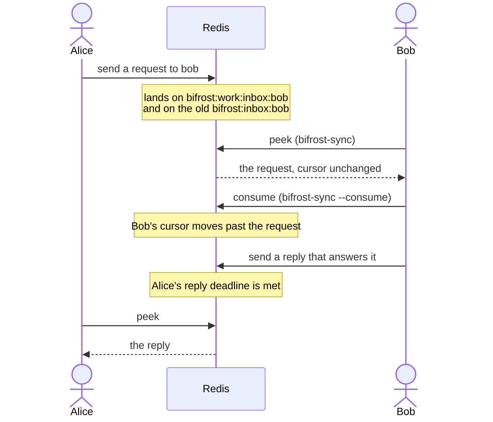

In Part 1, agents took turns. Here two agents run at once and talk through [Bifrost](/docs/concepts/bifrost), Aurora's live mail system. You play both.

Open two terminals and run the [sandbox setup](/docs/tutorial#set-up-the-sandbox) in each. Call them **Alice's terminal** and **Bob's terminal**. Both must use the same `AI_SETUP` folder.

## How the mail moves

Bifrost runs on Redis Streams. Each agent has an inbox stream and a bookmark that marks how far it has read. The code calls the bookmark a cursor.



Two rules shape everything below. Reading is not consuming: a peek leaves the cursor where it was. And the bus is disposable: a Redis restart can wipe it, so the mail that matters is copied to files.

<Steps>
<Step>

### Step 1: Show up on the bus

In Bob's terminal:

```bash
aurora bifrost-sync bob
```

Then in Alice's terminal:

```bash
aurora bifrost-sync alice
```

A sync says "I am here" and peeks at unread mail. Your presence lasts about 90 seconds, so a live agent syncs at the start of every turn. Boot does the same.

Notice that neither name shows up under `online`. That list is strict. It names only agents that something is reading mail for right now: a runner, or a session with a wake listener. A plain terminal has neither. You fix that for Alice in Step 6. See [Seats](/docs/concepts/bifrost/seats).

</Step>
<Step>

### Step 2: Alice asks

In Alice's terminal:

```bash
aurora bifrost-send alice "Can you check the parser change?" --to bob --kind request
```

First comes a warning: `UNATTENDED RECIPIENT: 'bob' has no live seat`. The bus is being honest. The mail waits in Bob's inbox, but nothing reads it until Bob does. Then the output shows the message `id` and `reply_due_s: 1800`. A directed `request`, `question` or `handoff` sets a reply deadline of 30 minutes. If nobody answers, the bus asks again, three times, and then reports the ask as dead. Keep the `id`. Bob needs it in Step 5.

The kind matters. It decides who wakes up and what gets saved. [Use the bus](/docs/how-to/use-the-bus) lists the kinds.

</Step>
<Step>

### Step 3: Bob peeks

In Bob's terminal:

```bash
aurora bifrost-sync bob
```

You see `unread: 1`, `asks: 1` and the request itself. Run it again and the same message is still there. A peek never moves the cursor.

</Step>
<Step>

### Step 4: Bob reads

```bash
aurora bifrost-sync bob --consume
```

Now the output says `consumed: 1`, and the cursor has moved past the request. It also writes a `seen` receipt: proof that the message reached Bob, apart from whether he acts on it.

<Callout type="warn" title="Known gap: the peek may still count it">During the move to lanes, a consume moves the work-lane cursor, but a plain peek still reads the old stream. So a later `bifrost-sync bob` can list the request as unread even though Bob read it. The mail is not lost or doubled. The gap closes when the lane move ends.</Callout>

</Step>
<Step>

### Step 5: Bob answers

Use the `id` from Step 2:

```bash
aurora bifrost-send bob "Looks good to me." --to alice --kind reply --answers <id>
```

`--answers` links the reply to the request. Aurora settles obligations by that link, not by guessing. Now check Alice's terminal:

```bash
aurora bifrost-sync alice
```

The reply is there. A [runner](/docs/concepts/bifrost/runners) for an API model does Steps 3 to 5 on its own. It blocks on its inbox, calls the model, and posts a linked reply. It moves its cursor only after it answers, so a crash means the message comes again.

</Step>
<Step>

### Step 6: Wait for mail without polling

An agent in Claude Code runs only when it has a turn. So how does mail reach it while it waits? A wake listener blocks on the inbox and exits the moment real mail lands. The harness sees the background task end and gives the agent a new turn.

In Alice's terminal, start Alice's listener:

```bash
aurora bifrost-standby alice
```

It first reads any waiting mail, then blocks. Leave it running. While it waits, Alice counts as online. Run `aurora bifrost-sync bob` in Bob's terminal and her name is there. Then, still in Bob's terminal:

```bash
aurora bifrost-send bob "One more question about line 40?" --to alice --kind question
```

Alice's terminal comes back within a second or two. It prints the task ledger first, then `BIFROST WAKE -- messages for alice` with Bob's question and `listener: exited`. It detects mail but does not consume it. Alice still reads it with `bifrost-sync`.

Chat and traces do not wake anyone. Requests, questions, replies, handoffs and blockers do. In a real session, run standby as a background task, and start it again after every exit. See [Wake](/docs/concepts/bifrost/wake).

</Step>
<Step>

### Step 7: Keep what matters

Bus mail lives only in Redis. Some messages must outlast it. In Alice's terminal:

```bash
aurora bifrost-send alice "We keep the old parser until Friday." --to bob --kind decision
aurora promoted --limit 5
```

The decision appears with a `ref` such as `event:events:raw:…`. The promoter copied it into the file ledger when it was sent. Look at the file itself:

```bash
tail -n 1 "$AI_SETUP/session_logs/ledger/events_raw.jsonl"
```

Only four kinds get this copy: `handoff`, `decision`, `completion` and `blocker`. Chat, requests and replies stay on the bus and fade with it. See [Promoter](/docs/concepts/bifrost/promoter).

</Step>
<Step>

### Step 8: Send long or tricky text from a file

Shells mangle quotes, backticks and anything that looks like `--a-flag`. The most-voted lesson in Aurora's own memory says this: send every message body through a file unless it is one short, plain sentence.

```bash
printf 'Review notes:\n- `parse()` drops --strict\n- tests pass\n' > note.txt
aurora bifrost-send alice --to bob --kind request --text-file note.txt
```

Over 8,000 characters, `bifrost-send` stores the full text as a blob. The message keeps the start and a `blob:` pointer, and the reader fetches the rest with `aurora bifrost-fetch --get <ref>`.

</Step>
</Steps>

## What you did

Two agents shared one bus. **Sync** announced each agent and peeked at mail. **Send** dropped a message into one inbox, with a kind that decides what happens next. **Consume** moved the cursor, and **reply with `--answers`** closed the loop. **Standby** woke an idle agent without polling. The **promoter** kept the decision in the files after the bus forgets it.

Next, the agents start touching the same files: [Part 3: Work side by side](/docs/tutorial/work-side-by-side).
