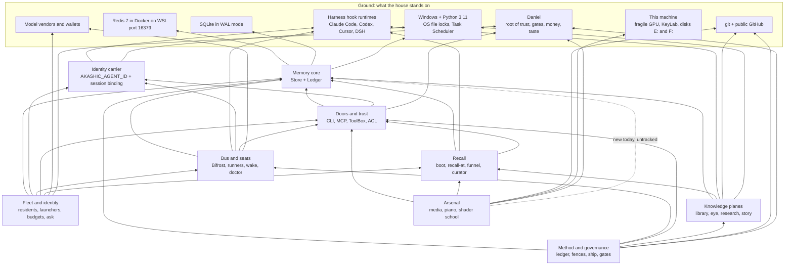

# The house, deconstructed: the whole-house teardown

- **Date:** 2026-10-13. Written 10:00 to 10:45 EDT, after the eight subsystem cards (09:29 to 09:55).
- **Seat:** Vandor (claude), a read-only subagent of the "deconstruct the house" workflow.
- **The ask, verbatim.** Daniel: "how do we expand reverse engineer into 'deconstruct and break down into first
  principles, required steps and capibilities and verification' I want us to be able to reverse engineer and
  deconstruct anything, from websites and api's to financial models to principles in the world." Then: "I love
  your deconstruct the house, yes!" He saw Rimuru's Great Sage in it, so this report closes in that voice.
- **Method:** `teardown-card.md` (draft v1, this folder). All eight rows, every claim labelled, loop altitude, the
  five traps named where seen, and a Great Sage report at the end.
- **Inputs:** the eight cards in this folder. A pointer like *(memory)*, *(recall)*, *(bus)*, *(doors)*,
  *(method)*, *(fleet)*, *(knowledge)* or *(arsenal)* means "measured on that card, which carries the file:line".
  **H1 to H19** are the house-altitude checks I ran myself today (section 9a).

**Labels.** **[obs]** observed, with a pointer. **[inf]** inferred, naming what it rests on. **[unk]** unknown,
naming where the search stopped. A bounded negative stays bounded: "not found in X" never becomes "absent".

**Read-only receipt.** I edited no house file except this one. What I ran: `knowledge-map` and `lookback` with
their counter kill switches set (`AKASHIC_KMAP_NO_COUNT=1`, `AKASHIC_LOOKBACK_NO_COUNT=1`); one `recall` read;
`status`; the doc-currency checker (it reads git log and ls-files only); `Get-ScheduledTask`; environment-variable
reads; a process list (names, ids and start times only); Redis reads only (SCAN, TYPE, TTL, XRANGE, LLEN); the
SQLite store opened read-only (`mode=ro`); git reads with `--no-optional-locks`. **I did not run `doctor`.** The
brief lists "doctor WITHOUT --page" as a read, but every doctor round is write-capable: page-grade findings always
escalate to the human pager, whatever `--page` says, and every round can retract standing pages, delete their
escalation keys and set or clear stall keys (`core/comm/doctor.py:138-155`, `:1604-1608`, `:1640-1642`,
`:1653-1720`; *bus* V2 replayed it). **The catch was partial, not clean** (corrected at review): the bus card caught
it in code and declined the verb; the doors and method cards ran it as a read before the catch reached them (their
side-effect blocks now say so, effect unknown); and I declined it. So: 1 card caught it in code, 2 ran it as a
read, the house seat declined it. This report still uses readings from those two runs (the doctor headline and its
grant rows, *doors*; the watch gauge, *method*), so it consumed their output while declining the verb. The brief
generator's read list still carries the wrong rule (a twin defect, outside this folder). Changing the rule is
Daniel's call.

**Side effects I caused,** stated so nobody mistakes them for organic traffic: the recall-at hook fired on about 25
of my shell calls (it bumps "surfaced" counters and writes injection-ledger rows); the trace hook beat the shared
seat record on each call; the one `recall` read may have bumped counters. My predictions were written to my
scratchpad before each test ran; a verbatim copy now lives in this folder as `predictions-house.md`, because a
scratch folder gets cleared.

**Privacy.** This folder is inside `research/in-flight/`, which git tracks, so this file may become public. I read
no private plane, personal memory, playing data, story oracle, shader corpus or secret-scan output, and I quote none.

**Where the card's eight rows live in this report:** Row 1 Purpose → section 1. Row 2 Observables → section 2.
Row 3 Mechanism → section 3. Row 4 First principles → section 4. Row 5 Capabilities → section 5. Row 6 Required
steps → section 6. Loop altitude → section 7. Row 7 Invariants and failure modes → section 8. Row 8 Verification →
section 9. Then surprises (10), what the house taught the method (11), and the Great Sage report (12).

---

## The picture in one paragraph (for Daniel)

Each card took one board out of the machine. Put back together, **the house is a whole computer**:
- the memory core is the memory hierarchy (Redis is the DRAM, SQLite is the SSD, the Ledger is the flight recorder);
- recall is the prefetcher;
- the bus is the interconnect, the doctor is the watchdog timer, and the pager is the non-maskable interrupt to you;
- the doors are the ports, and the ACL (access-control list) is the MMU's page table;
- the fleet is a multi-socket board: agent ids are core IDs, callsigns are hostnames, the identity law is Secure Boot;
- the method is the chip company's design-verification and sign-off flow;
- the knowledge planes are the storage subsystem and its search indexer;
- the arsenal is a discrete graphics and sound card, plus the workbench where your art gets made.

In network terms, every router has a **data plane** (it moves the packets) and a **control plane** (it decides,
checks and corrects). **The house's data plane is excellent:** 116,693 ledger and atom lines with none torn
*(memory)*, 1,028 atom bodies that rehash clean *(knowledge)*, a message loop that is closed and drilled (15 of 15
wakes in 24 hours arrived with mail, *bus*), an identity law that refuses exactly what it should *(fleet* V1*)*, and
RED-before-GREEN commits on at least 37 of 39 builds *(method)*. **The control plane is where it breaks.** The cards
traced 54 value loops. 7 are closed. 26 are open by defect, and 14 of those 26 are open for one of two plain
reasons: nothing reads the signal, or nothing turns the crank on a schedule (section 7). The house already holds
the diagnosis as a lesson, and recall returned it at rank 1 when I asked (H17): *the house reports what exists and
never what should exist and does not.*

**Thesis in one sentence.** The house writes, stores and measures very well, but its readers were built late,
aimed at the wrong population, or never wired; two thirds of its false first principles (18 of 27) are stale,
scope-dropped or unwired sentences that nobody re-measured, and at least two were wrong from the day they were
written; and its fixes land in one organ while the same bug lives on in that organ's twin.

---

## 1. Purpose (Row 1)

**What the house is for.** Akashic Aurora is a shared memory and nervous system for a small fleet of AI seats led
by one human. It exists so that (a) what one seat learns reaches the next seat **at the moment it acts**, (b)
seats can talk, wake and be trusted with bounded authority, (c) the work follows a method that **fires by itself**,
and (d) Daniel's own creative work (video, piano, light) has a workbench. **[obs]** `AGENTS.md:1-23` (the shared
memory and its doors); `docs/ARCHITECTURE.md:17-19` ("a message bus lets multiple agents work together ... and a
supervision layer keeps them alive", *bus*); Daniel's success bar quoted at `core/recall/at_action.py:1408-1410`
("you prefer what stops you failing, not what rescues you", *recall*); `docs/CONDUCT.md:61-63` and the plan's Wave E
("the doctrine fires by itself", *method*); `docs/LIBRARY.md:5-8` ("know where to find what we are looking for
instantly", *knowledge*); `arsenal/__init__.py:1` ("Daniel's modular media suite", *arsenal*).

**Whose outcome.** Daniel's first: he is the operator, the root of trust, the only source of money and the
creator. Every seat second. Future contributors to a public Apache-2.0 repo third. **[inf]** from the pointers
above and `docs/FOSSILS.md:5-11` (written for future contributors).

**The outcome that would make it worth keeping,** as four tests **[inf, from the eight cards' Row 1]**:
1. **Coverage:** a lesson learned once prevents the next failure. *Today: thin.* Prevention lift is +0.26 points on
   a 97% first-try baseline, and 1.9% of 28,847 impressions were ever judged *(recall)*.
2. **Delivery:** a message reaches the live being it names, and that being boots as itself. *Today: mail holds,
   names and identities do not.* The message loop is closed *(bus)*; three names (Neo, Astra, Asta) do not route, and
   Heimdall's and Navi's runners have been refused their own boots since 10-09 *(fleet)*.
3. **Truth:** the house tells Daniel the truth about itself. He is paged only when needed, always answered, and
   the house's self-reports match its territory. *Today: the outcome failing most.* `status` prints four calm lines
   (H15) while 23 lessons live only in the copy with no journal (H13); the doctor's headline says "0 page-grade"
   over two page rows *(doors)*; the spend audit says MATCH on an impossible state *(fleet)*.
4. **Craft:** Daniel makes and shares art he is proud of, faster. *Judged by his eye, outside the machine, by
   design* *(arsenal)*.

---

## 2. Observables (Row 2): the house measured from outside

All readings are from 2026-10-13. Card readings were taken 09:30 to 10:30; mine (H) 10:00 to 10:20.

| what | reading | source |
|---|---|---|
| Doors | `agent_cli.py` 11,220 lines, 113 verbs; MCP 76 tools; runner ToolBox 53 verbs | *doors* |
| Bus | `core/comm` 74 modules (28,029 lines) + `scripts/bifrost_*` (14,713 lines); 503 commits since 07-01 | *bus* |
| Arsenal | 465 tracked files, 130,660 lines; 117 more untracked | *arsenal* |
| Tests | 358 test files import `core.comm`; 45 touch fleet and trust; about 110 are named for the arsenal | *bus, fleet, arsenal* |
| Unpushed work | local master 77 commits ahead of origin/master (origin's last: 2026-10-07) | H10 |
| Redis db 0 | 118,258 keys, about 6x its 08-14 size; `appendonly no` (no running journal) | *memory* |
| Lessons | Redis 1,627, SQLite 1,604: **23 live only in Redis**, none with an expiry | H13 |
| Decision notes | Redis 1,175, SQLite 1,111 (64 apart) | H13 |
| Atoms / notes / in-flight files / eye events | 1,028 / 1,249 / 967 files (38 MB) / 61,036 | *knowledge* |
| Task ledger | 424 rows; 114 proposed, all stale; last completion 2026-09-26 | *method* |
| Recall | 6,288 recall-at calls in 24 h, 89% silent; 633 injections, about 285,000 tokens | *recall* |
| Boots since 10-01 | 280 served, 209 unverified (75%), 45 refused | *fleet* |
| Refused boots since 10-09 04:00 UTC | 32 events at the time of my scan (about 10:00): **30 runner-identity refusals** (a `claude` stamp asking to boot as kimi or deepseek; the fleet card's 30) **plus 2 sibling-workflow sessions** asking to boot as synthetic ids. The first two at 10-09 08:36:21 (kimi) and 08:36:23 (deepseek), local time. Re-read during the review fix pass: 36 by 10:23 (34 runner refusals; both runners refused again at 10:06 and 10:22-10:23) | exploratory scan (not pre-registered); split re-read from `events:raw` at review |
| Live seats / residents / grants | 5 live; 6 ratified residents; 14 grants, 2 expired | *bus, fleet, doors* |
| Alarms that stay red | nightly archive `ok:false` on 49 of 69 runs since 08-12; doc-currency FAIL, 17 violations; licence line 31 breaches (untracked files); reconciliation gate 1 of 33 substrate ships | H12, H16, *arsenal*, *method* |
| The house's clock | 16 `AkashicAurora-*` scheduled tasks; **none runs any of the seven drift readers named in H3** (MemWatch, Failsafe-Deadman and DaemonWatchdog do read gauges of their own) | H3 |
| Self-report | `status`: backend, two counts and a spine-health line; no warnings | H15 |
| Value loops traced | 54; 7 closed | section 7 |

---

## 3. Mechanism (Row 3): how the house turns an action into memory, and memory into the next action

**The main cycle, in seven steps** (each step **[obs]** on the card named):
1. **An agent acts inside a harness:** Claude Code, Codex, Cursor or DSH. Or a *runner* gives a stateless API model
   (DeepSeek, Kimi, Sol, Gemini) a body, an inbox and a lock *(bus)*.
2. **Hooks wrap every act.**
   - *Before it:* recall-at injects the few lessons that clear a relevance floor; two vetoes can stop the act (blanket
     git staging, a file a peer holds); a trace line beats the seat's liveness record.
   - *After it:* a fail-then-succeed "flip" credits whatever lesson was shown *(recall, doors)*.
3. **Doors write what was learned or said** into the memory core. The doors are the CLI, the MCP door and the
   ToolBox; the memory core is Redis (fast, shared, no journal) plus SQLite (journaled) plus append-only ledger files
   *(memory, doors)*.
4. **The bus carries mail** between seats and to Daniel. The wake ladder starts idle seats. The doctor reads
   liveness and writes pages *(bus)*.
5. **The knowledge planes capture.** Speech is captured automatically (the eye, daily). Findings are captured only
   when a seat decides to write a lesson, note, atom or file. Maps are captured only when someone regenerates them
   *(knowledge)*.
6. **The method decides what gets built:** ledger, fences, RED then GREEN, the ship door. Daniel gates *(method)*.
7. **The arsenal sits beside all this,** on narrow ports: the `media` verb, the recall-at hint, the piano cue
   channel *(arsenal)*.

**Three house-level mechanism facts that no single card could see:**

- **Every subsystem has a writer, a record and a reader, and the house's investment is front-loaded.** Writers and
  records are strong: 0 torn lines, 0 corrupt atoms, the identity law exact. Readers are late (the doctor before
  seats beat), mis-aimed (the directive watcher reading a six-line June stub; the eye's "operator" counting agent
  briefs) or missing (receipts, refusal events and budget flags with no reader). **[inf]** from *memory, bus,
  fleet, knowledge* (each names its own reader defects); section 7 counts them.
- **Only two channels push to a seat unasked:** the recall-at injection and pages rendered into prompts. Everything
  else waits to be pulled: knowledge-map has answered 46 queries in its life and lookback 29, against recall's
  28,847 surfacings *(knowledge* V4*)*. **[inf]** So an alarm that is not on one of those two channels reaches
  nobody unless a seat thinks to look, and none of the house's open alarms rides either channel.
- **Identity is the address bus, and it is a string that children inherit.** Every door keys on
  `AKASHIC_AGENT_ID` or a per-session binding. Both Claude settings files set it to `claude` (`.claude/settings.json:3`
  in the repo and in the user profile); the User and Machine environments do not set it at all **[obs H7]**. So
  every process a Claude session launches is "claude" unless its launcher overwrites the stamp. The house learned
  this on 2026-07-21 and fixed it at one door only: the ToolBox's exec children (`core/comm/toolbox.py:1826-1832`,
  "the runner inherited the LAUNCHING session's AKASHIC_AGENT_ID=claude") **[obs]**. The runners' own onboarding
  boot was never stamped, and since T418 (10-01) the identity law refuses it *(fleet* V2*)*.

---

## 4. First principles (Row 4)

### 4a. The house's nine first principles, merged across the eight cards

Verdict vocabulary (card v2's fixed list; normalised at review): **LAW** (an external law, cited), **MEASURED** (a
house incident with a receipt), **VALUE** (a stated value, quoted with its source), **DESIGN CHOICE**,
**CONTINGENT**, **STALE**, **SCOPED**, **FALSE**. An assumption dressed as an axiom (trap 1) is not a verdict: it
earns STALE, SCOPED or FALSE, and its cases are listed in 4b.

| # | principle | evidence | verdict | kept or broken today |
|---|---|---|---|---|
| HP1 | **A fact is durable only when it survives the death of any one copy.** That needs a crash-safe journal, a lock the operating system arbitrates, and a copy on another disk. | SQLite WAL (write-ahead log); FileStore lost 295 of 450 writes in a 3-process probe; the old ledger lost 410 of 18,170 rows (2.3%); the house's own "three copies, two media, one off-site" rule *(memory* F2, F3, F9*)* | **LAW + MEASURED** | **Broken.** 23 lessons, 64 decisions and 7 story beats live only in Redis, which runs with no journal *(memory* P3, P4; H13*)*. The SQLite store leaves disk E: only inside manual snapshots, the newest 19 days old (H11). |
| HP2 | **One writer per cursor, per record, per lock, arbitrated outside the process.** | Two readers on one stream offset silently eat each other's mail (the runner lock exists because this was hit live, *bus*); the kernel releases a dead holder's file lock *(memory)*; one GPU render at a time *(arsenal)*; a stale edit returns 409 *(arsenal)* | **LAW + MEASURED** | Held for runners and ledger appends. **Broken where the house assumed it for free:** "a seat is single-threaded, so its beat is work" failed live (seq 95 to 112 during one 16-second sleep, *bus* V5); atom appends take no lock *(memory)*; the peer-lock veto cannot separate two Claude sessions that share the id `claude` *(doors* I9, inferred*)*. |
| HP3 | **A field, or a name, must mean the same thing to its writer and to its reader.** A name is an address only where a router resolves it. | PRINCIPLES 5 ("names must not lie", the `Bus` class that was not a bus, *method*); the 2026-08-20 "vandor" mail accepted into a stream nobody read *(fleet)* | **VALUE + MEASURED** (PRINCIPLES 5 is the house's stated value; the "vandor" silence is the receipt). Corrected at review from LAW: the first sentence is a definition of a shared field, not an external law, and DNS is an analogy here, not a citation | **The most-violated principle in the house.** `since_ts` means "beating since" to its writer and "phase start" to the doctor *(bus)*; `AKASHIC_AGENT_ID` names the launcher, not the process *(fleet)*; `ratified_by: daniil` is a typed string *(fleet)*; "operator" includes agent briefs (22.8%, *knowledge*); there are three status vocabularies *(knowledge)*; "grant" means both an ACL right and a money line *(fleet)*; "L11" names two laws *(method)*; and the operator's own name lives in six code tables with four different contents (H4). |
| HP4 | **Evidence must be able to fail.** Presence proves the process, not the work. Zero is not no. A count without its population proves nothing. A check that cannot fail checks nothing. | The 2026-07-10 mail-loss forensics *(bus)*; removing exposure decay took the bench's rank-1 hits from 1 to 4 of 18 *(recall* F3*)*; the six-record stub incident (`staleness.py:152-156`, *knowledge*) | **LAW** (the logic of inference: a test that cannot fail carries no information) + **MEASURED** | Held where the house wrote it into code (presence vs progress; silence rows with reasons). **Broken in its instruments:** equal totals hid a two-way membership drift *(knowledge* V3*)*; `status` cannot see the Redis-only lessons (H15); the width gauge counts a state no work enters *(method* F4*)*. |
| HP5 | **A signal with no reader is cost, not safety.** Every alarm needs a listener with a budget, and a guard counts only on the road actually travelled. | "In plane after plane, nothing reads it" (`THE-FILING-SCHEMA.md:19-35`); M10 "every law has a forcing function on the road actually travelled"; PRINCIPLES 4 "guards over discipline" *(method)* | First sentence: **LAW** (decision theory: information that can change no action has zero value) + **MEASURED** here (section 7). The road clause is the house's own rule M10: **VALUE**. Normalised at review from "LAW-like", which is not a verdict | **Broken in 14 of 26 open loops** (section 7). PRINCIPLES 4 is half-true: a guard on an optional door (ship.py) is itself a remember-to convention *(method* F3*)*. |
| HP6 | **Identity is asserted, not authenticated; the operator is the root of trust.** The ACL is a seatbelt against mistakes, not a lock against a hostile shell, and the operator's lines are hard: privacy, the licence, his live session on port 8793, his fragile GPU, his money. | `core/trust/grant_writer.py:3-19` says so itself *(doors, fleet)*; `core/trust/private_plane.py:3-20` (Daniel's 2026-08-16 ruling); the 8793 refusal in code on both twins *(arsenal* V15*)* | **VALUE + DESIGN CHOICE**, stated honestly; fits a one-operator machine | Held where the code checks: the ToolBox, runner launch, the screen actuator, the bind refusal. **Overstated elsewhere:** "unknown agents are quarantined (read-only)" is false as a property of the whole system, since 282 of 1,625 lessons were written by 52 ids that resolve quarantined *(doors* V10*)*. |
| HP7 | **False autobiography is worse than amnesia: whose words a record carries is part of its truth.** | The Rill mangling and Daniel's correction, chronicle `b00b93:74-99` *(fleet)*; the eye's voice law (`core/eye/index.py:6-9`, *knowledge*) | **VALUE**, sourced and ratified | Enforced at the boot door (T418 refuses a stamp that names someone else, *fleet* V1). **Broken in the carriers:** the env stamp *(fleet* V2*)*, the fixture "ratified_by daniil" *(fleet* V6*)*, and the 22.8% *(knowledge)*. |
| HP8 | **Fail toward the cheaper error; the work outranks the hint.** | Recall and guards fail open; trust checks on write and exec fail closed; the wake janitor fails toward "alive" *(recall* F6, *doors* FP4, *bus)* | **VALUE + DESIGN CHOICE** | **Applied inconsistently.** The seat wedge page fails toward WEDGED *(bus)*; the ToolBox `kb.learn` gate fails open on a trust error *(doors)*. |
| HP9 | **The cost of a revert sets the ceremony, and independent reviewers reduce shared blind spots (they do not remove them).** | "What breaks if we revert this?" (`method-baseline:21-30`); Knight-Leveson, which the house cites for the opposite emphasis: "correlated blind spots are real; convergence is evidence, never proof" (`docs/method-baseline-2026-07.md:79-80`) | Revert cost: **DESIGN CHOICE** (a policy built on a real asymmetry). Independence: **SCOPED** (it reduces shared blind spots; two independent halves can still agree on the same error). Corrected at review: this row said LAW and "independence catches wrongness", which reversed its own source | **Unenforced:** 1 of 33 substrate ships carried its review record *(method* V8*)*; one seat opened all 19 recorded fences, which also narrows the independence the principle relies on. |

### 4b. Trap 1, house-wide: 27 assumptions dressed as axioms

They sort into six kinds. No card recorded, for each one, a date on which it was ever true, so "true when
written" is not established for any of them; and at least two were wrong from the day they were written (marked
below):

| kind | count | the cases (card) |
|---|---|---|
| **Scope dropped:** true at some doors or times, stated as true everywhere | 8 | "file is the source of truth"; "the Ledger is append-only"; "Hybrid degrades gracefully" *(memory)*; "unknown agents are quarantined" (**wrong from birth** at the shell door: added to `AGENTS.md` on 2026-08-03 in `6b494b91`, and the shell `learn` has never checked `kb.learn`; `git log -S kb.learn` and `-S KB_LEARN` on `agent_cli.py` return nothing); "the MCP door can never drift from the CLI" (**wrong from birth** for `bifrost_send`: in `ai_setup_mcp.py:10-11` by 2026-06-28, the day `bifrost_send` was written to call `Bus.send` directly, `83637308`) *(doors)*; "guards over discipline" *(method)*; "a conservative meter is a safe number" *(fleet)*; "the JSONL journal is the recovery truth" *(knowledge)* |
| **Stale:** a description or measurement that no longer matches, and was not re-measured | 7 | "a warm recall-at file read is about 1 ms" (9 ms measured; the whole call, 153 ms, was never priced); "the outcome stream holds two months" (7 days); "lessons decay on their own" in `AGENTS.md:98` *(recall)*; "acl.json is git-tracked" *(doors)*; "the one registry" (0 GLSL modules of 32); "`shader --help` lists the verbs" *(arsenal)*; `doctor --help`, "--page is what emits pages" *(bus)* |
| **Writer and reader mean different things** | 5 | `since_ts` *(bus)*; `AKASHIC_AGENT_ID`; `ratified_by` *(fleet)*; "the ledger is the coordination truth: obey THIS" (nothing writes completions back, *method*); "operator means Daniel" *(knowledge)* |
| **Unwired design:** a document describes a wire that is not connected | 3 | "boot multiplies proven lessons by their credit"; "benched lessons leave boot" *(recall)*; "the shelf can't rot" *(knowledge)* |
| **Concurrency or cadence assumed** | 2 | "a seat is single-threaded"; "a live seat beats every 45 s" *(bus)* |
| **No falsifier, or the remedy is unmeasured** | 2 | PRINCIPLES 3 and 5, "would revise: nothing" *(method)*; "a hint at the moment of action changes behaviour" (the re-mine has not run, *arsenal*) |

**[inf]** Better axioms are not enough. Each principle needs a **"last measured" date and a falsifier**, and a
clock that re-runs the cheap ones. Eighteen of the 27 are stale, scope-dropped or unwired, and at least two of
those 18 were wrong from birth: a measurement at the other doors, when they were written or since, would have
caught each of them. Whether the rest decayed or were never true is not known; the question "when was this last
measured?" is the right one either way.

---

## 5. The capability graph (Row 5): which subsystem needs which

An arrow `A --> B` means **A needs B to work**. The ground rows are what the house stands on.

Edges come from each card's "depends on" list **[obs per card]**. Three code checks back them up:
- **The memory core is the foundation in code, not only on paper.** 48 files across 10 of 12 packages import
  `core.foundation`: recall 6, comm 12, coord 8, narrative 11, fleet 2, library 2, learning 2, context 2, agent 2,
  arsenal 1 **[obs H19]**.
- **The eye keeps its own SQLite.** It imports only `core.eye.*` and one helper from the bus **[obs H6]**.
- **The arsenal stood off the memory core until this morning.** At 10:03 today a parallel workflow's untracked
  `arsenal/re/ledger.py:35` imported `core.foundation.ledger`. That came about 20 minutes after the arsenal card
  called the arsenal fully decoupled **[obs H5]**.

**What is truly foundational, in order** **[inf from the graph and the checks above]**:
1. **The memory core.** Everything except the arsenal stands on it (H19).
2. **The identity carrier.** It is the hidden foundation. Doors, bus, fleet, locks, attribution, credit and seat
   liveness all key on one self-declared string that child processes inherit (H7). It is also **the weakest
   foundation**, and the one the house built last: only one launch path of five stamps it *(fleet)*.
3. **The harness hook runtime.** It is the only place the house *sees* an agent act: recall injection, seat beats,
   traces and credit all ride it. Where hooks do not fire (MCP tools; Read and Grep on the after-side), the house is
   blind *(bus, doors)*.
4. **Daniel.** He is the root of trust, the gate on every proposal, the only source of money and the judge of taste.

**Leaves, not foundations:** the knowledge planes and the arsenal. Nothing else breaks if they stop.

**Capabilities the house must HAVE** (merged across cards; each **[obs]** on its card):

| kind | what |
|---|---|
| Infrastructure | Redis 7 with Streams in Docker/WSL; SQLite WAL; Python 3.11 via `py`; Node; Windows file locks; Task Scheduler; git and the public GitHub repo; Chrome (hardware decode, and SwiftShader for the shader lab); ffmpeg, PyAV, numpy, faster-whisper |
| Access | Harness hook events for every harness; vendor keys and prepaid wallets with balance endpoints; a vaulted OAuth token for resume-on-deaf; a signed-in Shadertoy session; the League replay API (it dies with patch 26.21 on 2026-10-21) |
| Data | The lesson corpus with a trigger discipline (1,168 of 1,624 trigger-shaped); the answer key (recall-bench, 25 of 40 seeded); transcripts from every harness; Daniel's recordings, practice log and private corpus (local only) |
| Know-how | Which store family is authoritative where; copy a WAL database only through the backup API; GLSL and shader maths; music theory; media timing |
| People and money | Daniel's gates and eye; independent seats for blind halves (Heimdall, Navi and Rill are live; codex, grok, gemini and sol are not on the roster); per-seat budgets |
| **Missing today** | A reader with a budget for every alarm; a clock for every hand-crank; a commit-to-ledger join; one name table; a seat identity per subagent; a restore drill; an off-disk copy of the SQLite store; the method's checks on the road every commit walks |

---

## 6. Rebuild from nothing (Row 6): if everything but the principles were lost

| step | build | what it lets us do | blocks |
|---|---|---|---|
| 0 | **Write the laws first:** HP1 to HP9 and the operator's hard lines, each with a falsifier and a "last measured" date | Every later step has something that can fail | everything (cheap) |
| 1 | **Storage:** a fail-fast Redis connector; the Store + Ledger contract; a SQLite WAL durable tier; appends under an OS lock; Redis with its journal on | Any seat remembers and replays; a power cut loses nothing | all below |
| 2 | **The identity carrier:** a per-session binding; **every launch path stamps its child**; one name table (callsigns, operator ids, exemptions) derived from one registry | Attribution, locks, grants, routing, credit and liveness all mean something | 3, 4, 5, 8 |
| 3 | **Field contracts:** write down what each shared field means to every writer (`since_ts`, phase, status, "operator", "grant") and pin writer and reader together | A reader can trust a writer | every reader (6, 8) |
| 4 | **Doors:** the CLI; the MCP door as a thin wrapper over the same functions; the ToolBox with fail-closed ACL gates for unattended seats; hooks with the two vetoes | Every harness reaches the memory; unattended seats stay bounded | 6 |
| 5 | **Bus:** per-agent inbox streams with per-reader cursors; the runner lock before any second runner exists; one runner; the wake ladder | Seats talk and wake | 8 |
| 6 | **Recall, answer key first:** the bench, then the floor, anti-repeat, faithfulness, the outcome join, and credit into *both* rankers through one helper | Lessons reach the moment of action and get judged | - |
| 7 | **Knowledge planes with freshness built in:** maps regenerate on write or on a clock, and print their age | Findings are found again | - |
| 8 | **Readers and clocks:** one vitals reader with a staleness budget per alarm, run on a schedule; pages carry an ack and leave a record | The house knows when it is lying; Daniel is paged only when needed | 9, 10 |
| 9 | **The road:** method and licence checks on the hooks every commit walks, as new-debt ratchets; a Scribe that joins commits to the ledger | The method fires by itself | - |
| 10 | **Drills:** a restore into a twin, and cold starts for every lever, each with a dated receipt; off-disk copies | "We built it" becomes "we know it works" | - |
| 11 | **The arsenal on its narrow waist:** exact time, typed ports, the bench before visual iteration, the licence line before the library's licence | Art, on a card that barely touches the motherboard | needs 9 for the licence floor |

**Critical path: 1 → 2 → 3 → 8 → 10.** Steps 4 to 7 hang off step 3, and step 9 hangs off step 8. **[inf]** from the
dependency column and each card's own critical path.

**The order the house actually took, and what it cost.** The house built 1, 4, 5, 6, 7 and 11 thoroughly. It built
step 2 for one launch path of five, never did step 3 as a step, built step 8 as a doctor without a field contract,
built step 9 as an optional door, and did step 10 for the wake ladder only. Five subsystems independently show the
same signature: **a reader built before the writer's contract was made true.**

| reader built | when | the writer's contract it relied on | when | what it cost | card |
|---|---|---|---|---|---|
| The doctor's wedge page | 2026-07-11 (`c6265788`) | Seats beat at all; `since_ts` honoured | 2026-08-02; never | Eight dated false-page fixes, then W263 | *bus* |
| The T418 identity gate | 2026-10-01 | Every launch path stamps its child | 1 of 5 paths | 30 refused runner boots from 10-09 to the morning of 10-13 (34 by 10:23; section 2 reconciles this with the 32 events of the scan) | *fleet* |
| The method checkers | 2026-07-11 (`303c2b30`) | A road every commit walks | never built | 1 of 33 substrate ships gated | *method* |
| Recall's floor | 2026-07-01, calibrated on n=1 credited pair | An answer key (the bench) | late September | Abstains 0 of 6 when silence is right | *recall* |
| The generated shelves and story atlas | LIBRARY v1 | A freshness trigger | never built | 6 days and 105 commits stale | *knowledge* |

---

## 7. Loops: every value loop the cards found

Status codes: **C** closed · **P** partly closed · **I** open on purpose (a fence: Daniel's gate or a Goodhart
guard) · **O** open by defect or omission, followed by the broken link in brackets.

| card | loop | status |
|---|---|---|
| memory | write → dual-write to SQLite + Redis | P (a JSON-tier writer bypasses SQLite) |
| memory | boot heal: drift → backfill | P (one way only) |
| memory | twin-drift checker → operator | O [no reader; standalone run crashes] |
| memory | knowledge snapshot → age budget | O [no clock] |
| memory | nightly archive → receipt → reader | O [no reader] |
| memory | restore → drill receipt | O [never exercised] |
| memory | capped ledger streams → archive | O [two correct rules collide] |
| recall | credit → recall-at ranking | C |
| recall | credit → boot ranking | O [twin defect: bare key] |
| recall | curation → surfaces | O [no clock: hand-crank idle 33 days] |
| recall | seat experience → votes | P (1.9% judged) |
| recall | outcomes → mined triggers | O [horizon starved: 2.3 h] |
| recall | outcomes → prevention measure | I (measure, never steer) |
| recall | repeats → reminder-to-gate ladder | O [not built] |
| recall | funnel trend → operator | O [horizon starved: 6.4 h] |
| bus | alarm loop → page → Daniel → back | P (no debounce; the human half has no ack and no record) |
| bus | message loop | C (drilled) |
| bus | code freshness → self_restart | P (open for discord) |
| doors | grant loop | O [measured, not actuated: 2 grants expired 7 to 8 days] |
| doors | recall injection | P (verb hints unledgered) |
| doors | quarantine onboarding | P (closed at the ToolBox, never starts at the CLI/MCP) |
| doors | hook-twin maintenance | P |
| doors | lock TTL lapse | P (3 locks never expire) |
| method | friction → captured | C |
| method | captured → promoted or retired | P (0 declines ever) |
| method | promoted → designed (fences) | P |
| method | designed → built (RED → GREEN) | C |
| method | built → shipped through the gate | O [guard off the road] |
| method | shipped → recorded in the ledger | O [no join] |
| method | recorded → measured | C |
| method | measured → acted on | O [no reader: M1's 3% reaches only wrap] |
| method | acted → amended (C6 sweep) | O [no clock] |
| method | customer loop (Siemens round, GO/NO-GO, andon) | O [not built] |
| fleet | identity: launcher → boot → fold → receipts → routing | O [writer contract + no reader for refusals] |
| fleet | money: meter → wallet → gate → operator | P (upward-only; refusals reach no gauge) |
| fleet | ask → expectation → settle | P (one-shot senders never settle) |
| fleet | value of identity (calibration) | P (n=7, nearly dry) |
| knowledge | speech → eye | C (lag up to 24 h) |
| knowledge | finding capture | O [starved: findings go where no door reads] |
| knowledge | map freshness | O [no clock] |
| knowledge | retrieval | P |
| knowledge | use → judgement | O [no reader: "credit UNKNOWN"] |
| knowledge | promotion and draft curation | O [no clock] |
| knowledge | supersession | P (3 of 4 back-links missing) |
| knowledge | negative knowledge (FOSSILS) | O [no reader: warned 95 days, nobody acts] |
| knowledge | directive watch | I (proposes only, by Daniel's design; mis-aimed) |
| arsenal | story loop (piano → page) | I (the last link waits at Daniel's gate) |
| arsenal | reach loop (toolbox re-mine) | O [no clock: due about 10-19, unscheduled] |
| arsenal | licence loop | O [guard off the road] |
| arsenal | parts loop (atlas) | C |
| arsenal | upgrade loop (approved looks) | I (the one question, his) |
| arsenal | calibration (forecasts) | O [no clock: F012, F013 23 and 29 days late] |
| arsenal | look loop | P (honestly bounded) |
| arsenal | registry loop (GLSL) | O [not built] |

**Tally [obs, counted from the table]:** 54 loops: **7 closed (13%)**, 17 partly closed, 4 open on purpose,
**26 open by defect or omission (48%)**.

**Where the 26 break:**

| broken link | count | the loops |
|---|---|---|
| **No reader:** measured, and nothing acts | 7 | twin-drift checker, archive receipts, grant expiry, M1 measure, refused boots, eye "credit UNKNOWN", FOSSILS |
| **No clock:** a hand-crank nobody turns | 7 | snapshots, the curator, the C6 amendment sweep, map regeneration, draft curation, the toolbox re-mine, forecast scoring |
| **Not built or never exercised** | 4 | restore drill, reminder-to-gate ladder, the customer loop, GLSL registry |
| **Guard or join off the road commits travel** | 3 | ship.py's checks, commit → ledger, licence line |
| **Horizon starved or wrong population** | 3 | mined triggers, funnel trend, finding capture |
| **Twin-organ defect** | 1 | boot's credit key |
| **Two correct rules collide** | 1 | trimming vs refuse-shrinking |

**The biggest finding of the teardown [inf, from the two tables].** Half the house's value loops are open, and more
than half of those (14 of 26) need no new idea to close: a reader for a signal the house already produces, or a
clock for a crank the house already built. The house's only automatic clock, Task Scheduler, runs 16 tasks:
watchdogs, services, capture and archiving, one secret scan and one wishlist triage. **None of them runs any of
the seven drift readers:** the doctor, the library generator, the curator, the knowledge snapshot, the twin-drift
checker, the doc-currency checker and the scorecard **[obs H3]**. (Some watchdogs, such as MemWatch,
Failsafe-Deadman and DaemonWatchdog, read gauges of their own; they do not read drift.) The pipes and the gauges
exist. What is missing is the wire from
the gauge to the hand. The house's own 2026-09-23 lesson (H17, rank 1) already designed the fix: an expected-up
roster of things that *ought* to move, each with a maximum-silence budget, "so that a missing one is a ROW rather
than a gap".

---

## 8. Invariants and failure modes (Row 7) across the house

### 8a. House invariants

| # | invariant (what must always hold) | today | evidence |
|---|---|---|---|
| HI1 | Every durable record has a journaled copy and an off-disk copy | **broken** | 94 records live only in Redis, `appendonly no` (H13, *memory* P3); the newest snapshot is 19 days old and on the same disk (H11) |
| HI2 | One writer per cursor, record and lock | **held** for runners and ledger appends; **broken** for seat records, atom appends, and Claude-to-Claude peer locks | *bus* V5; *memory* F-I; *doors* I9 |
| HI3 | A field means the same to its writer and its reader | **broken in at least 8 fields** | HP3 row above; H4 |
| HI4 | Every alarm has a reader that acts within a budget | **broken** | section 7: 7 loops have no reader; H3 |
| HI5 | Every name routes to exactly one live being | **broken** | Neo, Astra and Asta pass through unrouted; one codex seat holds three mailboxes *(fleet* V7*)* |
| HI6 | The human is always answered, paged only when needed, and never misquoted | **broken** | Navi's budget exemption lacks `daniil` (H4, *fleet* V15); the false HARD WEDGE page (W263, *bus* V1-V3); 22.8% of "operator" rows are agent briefs *(knowledge)*; the doctor calls his inbox "ghost mail from a retired seat" *(bus* I8*)* |
| HI7 | Every seat boots as itself | **broken** for Heimdall and Navi since 10-09 | *fleet* V2; the first refusals 3.5 minutes after the 10-09 restart (exploratory scan, H8) |
| HI8 | Tests never write the production plane | **broken (residue)** | 3 fixture residents (a real id, `cursor`, boots as "Compass", *fleet* V6); 3 test locks with no expiry *(doors* V13*)*; test asks in `state/asks/` *(fleet)* |
| HI9 | Ephemeral things end | **broken** | 12 seat death-witness keys, 3 locks and 7 peer-ask expectations with no expiry *(bus* V9, *fleet* V18*)* |
| HI10 | Public stays clean: no private material and no corpus code in a tracked file | **held on the tracked tree** (273 baseline entries held, 0 grown; 0 files tracked under `state/arsenal`) but **ungated**: 31 breaches sit in untracked files, one `git add` away | *arsenal* V1; H14 |
| HI11 | The house's self-reports match its territory | **broken** | `status` (H15); the doctor headline *(doors)*; `--verify` CLEAN over a header that lies *(knowledge* I2*)*; the spend audit MATCH *(fleet* V14*)*; "watches 2/2" *(method)*; a refusal reported as CLOSED.ANSWERED *(fleet* V16*)* |
| HI12 | Fail toward the cheaper error | **inconsistent** | *bus* (seat page), *doors* (`kb.learn` fails open) |

### 8b. How the house breaks, and what a break looks like from outside

1. **Quiet green (a stuck-at-0 fault line).** The break reads as health: equal totals, a CLEAN verify, an audit
   MATCH, "watches 2/2", four calm `status` lines. **This is the commonest signature** *(knowledge, fleet, method,
   memory)*.
2. **Always red (a stuck-at-1 fault line).** An alarm that never clears carries no more information than one that
   never fires:
   - the nightly archive, `ok:false` on 49 of 69 runs (H12);
   - doc-currency, 17 failures since August (H16);
   - the licence line, red since mid-September *(arsenal)*;
   - M1-PV, with a 9/9 and a 7/7 false-alarm rate *(method)*.

   The house's own lesson from 2026-08-06 predicted the damage: "a gate that cries catastrophe on a thin margin
   disarms itself"; the real damage is "pedagogical" (H17 result 3).
3. **Twin-fix: the class lives on in the sibling organ.** Six pairs, each **[obs]** on its card:

   | fixed here | still broken here | card |
   |---|---|---|
   | `staleness.py` reads the real lesson population | the directive watcher reads the six-line June stub | *knowledge* |
   | `standing` filters subagent briefs out of "his voice" | `freq` and `stats` do not | *knowledge* |
   | recall-at reads canonical credit keys and skips benched lessons | boot does neither | *recall* |
   | the ToolBox stamps its children's identity (07-21) | runner onboarding does not | H7, `toolbox.py:1826-1832` |
   | T418's synthetic-identity sweep, after the 10-07 lesson | inherited-identity runners | H17, *fleet* |
   | the PreToolUse hook twin is pinned and ported | the UserPromptSubmit twin is not | *doors* |

   The house holds the lesson for this exact class ("when a fix primitive is born, sweep the class that birthed
   it", *knowledge*). Lessons carry the knowledge across; they do not carry the sweep.
4. **The reader comes before the writer's contract.** Five instances (section 6).
5. **Test residue in production:** fixture residents, test locks with no expiry, test asks (HI8).
6. **One name, many tables:** the operator appears in six code tables with four different contents (H4). The fleet
   keeps its names in five tables that never join *(fleet)*.
7. **The observer is in the territory.** Tonight's read-only fan-out beat one seat record from several actors
   *(bus* V5*)*, pushed injections and bumped counters on every shell call (every card), and a sibling workflow
   changed the arsenal's coupling while it was being measured (H5). A teardown of a live house is part of what it
   measures.

---

## 9. Verification (Row 8)

**The direction column.** "Held" means opposite things depending on what a prediction tests, so every row below
says which:
- **C** tests one of the house's own claims; a FAILED C row is a defect.
- **D** tests the auditor's defect hypothesis; a HELD D row is a defect.
- **F** tests a proposed fix's effect, by replay.
- **G** tests a claim made in this report.

### 9a. House-altitude predictions (mine, registered before each test)

| # | prediction | test | result | verdict | dir |
|---|---|---|---|---|---|
| H1 | The teardown folder is invisible to knowledge-map | `knowledge-map --json deconstruct the house teardown card great sage first principles` (counter off) | 7 surface nodes, 0 from `research/in-flight`. Side observation: library projections are titled "---" (the reader takes the YAML fence for the title) | held | D |
| H2 | ...and to lookback's research layer | `lookback --layers research --json ...` (counter off) | `[]` | held | D |
| H3 | No scheduled task runs a drift reader | `Get-ScheduledTask` actions | 16 `AkashicAurora-*` tasks: watchdogs, services, capture, archives, a secret scan, wishlist triage; none names doctor, `gen_library`, `recall-curate`, `snapshot_knowledge`, `check_dual_authority`, `check_doc_currency` or `arc_scorecard` | held | D |
| H4 | At least 3 operator/exempt id tables exist, and one lacks `daniil` | Grep of production Python | **6 tables, 4 different contents**; the kimi and gemini runners' `BUDGET_EXEMPT_SENDERS = {"user","daniel"}` both lack `daniil` (`bifrost_runner_kimi.py:95`, `bifrost_runner_gemini.py:86`); the others are in `discord_bridge.py:115`, `discord_feed.py:69`, `mailbox.py:974` and `conductor_gate.py:89` | held | D |
| H5 | The arsenal imports nothing from core, agent or scripts | Grep of `arsenal/**/*.py` | **FAILED on the working tree:** `arsenal/re/ledger.py:35` imports `core.foundation.ledger` (untracked, written 10:03 by the reverse-engineering workflow). The tracked tree still holds 0 | **FAILED** | C |
| H6 | The eye imports nothing from `core.foundation` | Grep of `core/eye` | only `core.eye.*` plus `core.comm.bus.sid8` | held | G |
| H7 | `AKASHIC_AGENT_ID` is not set at User or Machine level; the `claude` stamp comes from Claude settings | env reads; Grep of both settings files | User and Machine unset; `"AKASHIC_AGENT_ID": "claude"` at line 3 of both the repo's and the user's `.claude/settings.json` | held | D |
| H8 | The live deepseek and kimi runners' parents are gone | `Win32_Process` parent lookup | both runners (07:48:20 and 07:48:43) and both their daemons have dead parents. The claude WakeDaemon's parent, the Task Scheduler host, started 10-09 08:32:51, which **[inf]** dates a restart that morning | held | D |
| H9 | T418 still reads `proposed` | read `state/coord/tasks.json` | T418, T420-T423 `proposed`; T031 `parked` | held | D |
| H10 | More than 76 commits are unpushed | `git rev-list --count origin/master..HEAD` | 77 | held (weak: hours after the card) | D |
| H11 | The newest snapshot is still 2026-09-24 | `ls backups/snapshots` | `20260924_224413` | held (weak) | D |
| H12 | The newest archive receipt reads `ok:false` | read the receipts | `ok:false`; **49 of 69 receipts false since 08-12** | held | D |
| H13 | Redis holds at least 23 lessons the SQLite tier lacks | Redis SCAN vs SQLite `mode=ro` | **exactly 23**, none with an expiry, 0 the other way; 2 new lessons since the card reached both tiers, so the gap is not growing today. Decisions: 1,175 vs 1,111 | held | D |
| H14 | `audio-music.md` is still uncommitted | `git log` and `git status` | untracked; the same workflow committed a sibling file from that folder at 09:41 | held | D |
| H15 | `status` warns about none of the measured defects | `py agent_cli.py status` | four lines, no warning | held | D |
| H16 | doc-currency still fails with at least 17 violations | the checker | 17, exit 1 | held (weak) | D |
| H17 | Recall already holds the house's own diagnosis | `recall "alarm nobody reads staleness budget" --json` | rank 1 is `the_house_reports_what_exists_and_never_what_should_exist_and_does_not`; rank 3 is the always-red lesson; rank 7, `a_correct_identity_gate_breaks_every_organ_that_impersonated_one` (2026-10-07), describes T418's class | held | D |
| H18 | No page is standing right now | Redis TYPE/LLEN `bifrost:pages` | key absent, so 0 pages | held | C |
| H19 | The memory core is imported by recall, comm, fleet, coord and library, but not by trust | Grep per package | recall 6, comm 12, fleet 2, coord 8, library 2, trust 0 (plus narrative 11, learning 2, context 2, agent 2, eye 0, arsenal 1 untracked) | held | G |

**Exploratory, not pre-registered:** an `events:raw` scan since 10-09 04:00 UTC found 32 refused boots: 30 runner
refusals (the fleet card's 30) plus 2 sibling-workflow sessions asking to boot as synthetic ids (split re-read at
review). The first two came at 08:36:21 and 08:36:23 local on 10-09, 3.5 minutes after the restart that H8 dates.

**Score:** 19 run, 18 held, 1 failed (H5). Several held predictions are weak, because a card had measured the same
state hours earlier (H10, H11, H16). Their value is replication, not discovery. The strongest were H4, H7, H13
(replicated exactly by an independent probe), H17, and H5, which failed because the territory moved under us.

### 9b. Every prediction the eight cards ran (108)

**Memory core** (10)

| id | prediction | result | verdict | dir |
|---|---|---|---|---|
| P1 | The refused ledger files shrink by cap trimming | 21,522 / 6,418 / 10,552, all inside the trim band | held | D |
| P2 | The twin-drift checker flags a tear over 24 h | DIVERGENT-DUAL, 5.4 d; the documented form crashes | held | D |
| P3 | Redis runs with no journal | `appendonly no` | held | D |
| P4 | SQLite holds every durable key Redis holds | 23 lessons, 64 decisions, 7 beats Redis-only | **FAILED** | C |
| P5 | Then those lessons sit in the JSON twin | 21 of 23 | held | D |
| P6 | No torn lines | 1,386 / 0; 115,307 / 0 | held | C |
| P7 | No scheduled snapshot | none; a dead "Redis Backup" task | held | D |
| P8 | The atom diff is additions only | +8 / -0 | held | C |
| P9 | `status` reports Redis + SQLite | yes, and it cannot see P4 | held | C |
| P10 | `events_raw` crosses its trim line about 11-06 | a forecast | not run | - |

**Recall** (13)

| id | prediction | result | verdict | dir |
|---|---|---|---|---|
| V1 | Boot multiplies proven lessons by credit | the bare key gives 1.0 (canonical 1.42) | **FAILED** | C |
| V2 | Benched lessons stay out of boot | 56 of 56 admitted | **FAILED** | C |
| V3 | A filler prompt stays silent | silence | held | C |
| V4 | `cd` into a subfolder surfaces the cd-wedge lesson | query reduced to `scripts`; `git add -A` gives an empty query | **FAILED** | C |
| V5 | The warm file read takes about 1 ms (the docstring prices the read, not the call) | read 9 ms; the whole call, never priced, 153 ms warm, 506 ms first, 0.82 s CLI | **FAILED** | C |
| V6 | The 14-day trend covers 14 days | reaches 6.4 h | **FAILED** | C |
| V7 | The outcome stream holds two months | about 7 days | **FAILED** | C |
| V8 | Mined triggers sharpen matching | 2 of 1,540 items | **FAILED** | C |
| V9 | If the curator stops, the probes freeze (the code's own warning) | the same 3 since 07-08 | held | D |
| V10 | The curator ran within its 10-day gate | 33 days; 369 waiting | **FAILED** | C |
| V11 | The bench abstains when silence is right | 0 of 6 | **FAILED** | C |
| V12 | The outcome sink is where the docstring says | redefined at `:990` | **FAILED** | C |
| V13 | A graduated rule stays silent for `git add -A` | empty query: could not fail | inconclusive | C |

**Bus and seats** (11)

| id | prediction | result | verdict | dir |
|---|---|---|---|---|
| V1 | The false page is a 45-second cliff | 44 s or less: working; 46 s or more: HARD WEDGE page | held | D |
| V2 | A round without `--page` writes the pager | set + lpush pages | held | D |
| V3 | Retraction wipes the dedup, so flaps re-page | 3 pushes in 5 rounds | held | D |
| V4 | `since_ts` ignores phase changes (live) | 124 s old; phase under 1 s | held | D |
| V5 | A seat is single-threaded | seq 95 → 112 in one sleep | **FAILED** | C |
| V6 | No human door acks a page | only the auto-retract and the daemon | held | D |
| V7 | No page-grade finding right now | 0 of 12 agents | held | C |
| V8 | The gauges agree per agent | LIVE / CRITICAL / GONE for dsh_agent | **FAILED** | C |
| V9 | Death-witness and lock keys expire | 12 + 3 at TTL -1 | **FAILED** | C |
| V10 | `self_restart` keeps runners current | discord 60 commits behind | **FAILED** | C |
| V11 | The `since_ts` fix silences the commit page and keeps the hang page | silent / dashboard / page | held | F |

**Doors and trust** (13)

| id | prediction | result | verdict | dir |
|---|---|---|---|---|
| V1 | An unknown or empty id is quarantined | 2 caps | held | C |
| V2 | The expired grants are quarantined | 193 h, 164 h | held | D |
| V3 | dsh_agent's write cap is unusable; its sends are wider than its role | False / ALL / True | held | D |
| V4 | `acl.json` is gitignored (the docs say tracked) | `.gitignore:225` | held | D |
| V5 | The hinted `agent_cli trace` does not parse | invalid choice | held | D |
| V6 | The verb index exceeds the 113 real verbs | 152 entries | held | D |
| V7 | The doctor shows the expired grants | yes; the headline says 0 page-grade | held | C |
| V8 | Both hook registrations fire (paired traces) | 0 pairs in 4,914 rows | **FAILED** | D |
| V9 | The parity gate passes on names | PASS while `bifrost_send` behaves differently | held | D |
| V10 | Quarantined ids wrote lessons | 282 lessons, 52 ids | held | D |
| V11 | Non-ACL agents send on the bus | only the human | inconclusive | D |
| V12 | Verb-only hints are not ledgered | 0 vs 1 | held | D |
| V13 | Lock keys carry an expiry | all 3 at -1 | **FAILED** | C |

**Method and governance** (14)

| id | prediction | result | verdict | dir |
|---|---|---|---|---|
| V1 | The two-watch cap holds | 2/2 | held | C |
| V2 | Work passed through the counted state | 6 of 6 bypassed it | **FAILED** | C |
| V3 | Shipped work is closed in the ledger | T418-T423 `proposed` | **FAILED** | C |
| V4 | T031 agrees with git | "unbuilt" vs "complete" | **FAILED** | C |
| V5 | The gate refuses a non-reconciliation citation | PASS on the letters "gate" | **FAILED** | C |
| V6 | The gate protects every tier-1 path | NOT_APPLICABLE | **FAILED** | C |
| V7 | The gate accepts a fence's reconciliation | FAIL | **FAILED** | C |
| V8 | Substrate ships meet M1 | 1/33 and 1/31 | **FAILED** | C |
| V9 | Doc-currency passes the ratified docs | 17 violations | **FAILED** | C |
| V10 | Boot stamps the current conduct version | v1 vs v2 | **FAILED** | C |
| V11 | ORG's understudies landed | 0 of 9 | **FAILED** | C |
| V12 | The fence verb sees every folder | 24 of 33 | **FAILED** | C |
| V13 | The skill mirrors are identical | identical | held | C |
| V14 | RED comes before GREEN | at least 37 of 39 | held | C |

**Fleet and identity** (18)

| id | prediction | result | verdict | dir |
|---|---|---|---|---|
| V1 | The identity law refuses and serves correctly | refused / served / served | held | C |
| V2 | The live runners booted as themselves | refused within 1 to 6 s; 30 since 10-09 | **FAILED** | C |
| V3 | A refused boot leaves onboarding empty | the refusal is folded in as onboarding (replay) | **FAILED** | C |
| V4 | Callsign receipts are self-authored | 10 of 10 | held | C |
| V5 | The ceremony refuses a non-human ratifier | rule 3 accepts anyone | **FAILED** | C |
| V6 | No fixture identity in the live registry | 3 (`cursor` = Compass) | **FAILED** | C |
| V7 | Every name in the brief routes | Neo, Astra, Asta do not | **FAILED** | C |
| V8 | Every resident has a lever | Souei none; 3 levers undrilled | **FAILED** | C |
| V9 | Neo can act | quarantined (expired) | **FAILED** | C |
| V10 | The `navi` grant governs Navi's runner | inert | **FAILED** | C |
| V11 | The meter agrees with the wallet | apart by roughly 15% of the budget | **FAILED** | C |
| V12 | Tonight's refusal was right on either reading | refuses both ways | held | C |
| V13 | The refusal text names the line it used | it names the fixed refuse constant; the decision used the budget-scaled line | **FAILED** | C |
| V14 | The spend audit flags spent > budget | MATCH | **FAILED** | C |
| V15 | Daniel's bus id is exempt | `{user, daniel}` | **FAILED** | C |
| V16 | A refused ask reads as refused | CLOSED.ANSWERED | **FAILED** | C |
| V17 | The `budget_refusal` flag has a reader | none | **FAILED** | C |
| V18 | Durable asks always end | 7 armed, TTL -1 | **FAILED** | C |

**Knowledge planes** (13)

| id | prediction | result | verdict | dir |
|---|---|---|---|---|
| V1 | Currency flags FOSSILS as stale | 95 d | held | D |
| V2 | `standing` reads exactly 1,026 sources | 1,026; its top "directive" is machine text | held | D |
| V3 | The store and journal counts match | equal totals, but the members differ in both directions | held (misleading) | C |
| V4 | The map doors are rarely used | 46 and 29 queries ever | held | D |
| V5 | `--verify` gives 0 corrupt / 0 drift / a small missing count / about 14 orphans | exact on all four (the missing count includes the private overlay and is withheld) | held | D |
| V6 | The story atlas lags | 0 chapters on 4,178 beats | held | D |
| V7 | knowledge-map finds the filing schema | relevance 1.0 | held | C |
| V8 | An in-flight SPEC is not surfaced | not surfaced | held | D |
| V9 | `recall` misses the second-press atom | missed | held | D |
| V10 | The `arc` verb does not exist | invalid choice | held | D |
| V11 | Fossil atoms land on the live surface | 2 fossils at 1.0 | held | D |
| V12 | Research is read by title only | deep body 0 / title 1.0 | held | D |
| V13 | Atoms minted after the shelves are absent | 0 of 5 | held (weak) | D |

**Arsenal** (16)

| id | prediction | result | verdict | dir |
|---|---|---|---|---|
| V1 | The licence line holds | 31 breaches in 9 untracked files | **FAILED** | C |
| V2 | The P0 list is not fully built | 193 of 193 built | **FAILED** (good news) | D |
| V3 | The library passes its floors | clean | held | C |
| V4 | The page index is current | STALE | **FAILED** | C |
| V5 | `shader --help` lists the verbs | errors; 5 of 16 | **FAILED** | C |
| V6 | GLSL modules sit in the registry | 0 of 32 | **FAILED** | C |
| V7 | Forecasts were scored after their horizons | F012 and F013 open | **FAILED** | C |
| V8 | The old graphs still plan | exit 0 | held | C |
| V9 | Every preset reads audio | 8 of 8 (1 cosmetic) | held | C |
| V10 | Every module names an existing twin | 68 of 68 | held | C |
| V10b | At least 90% of functions are twinned (with a negative control) | 278 of 278 | held | C |
| V11 | Both finders pick the same ffmpeg | different builds | **FAILED** | C |
| V12 | The media doctor path loads no heavy libraries (with a control) | 0 | held | C |
| V13 | The census claims still hold | yes | held | G |
| V14 | The GPU lock is free | free | held | C |
| V15 | The shader server refuses 8793 | refused; 8797 allowed | held | C |

### 9c. What the failures teach

- **Read by direction, 78 of 108 card predictions exposed a defect** **[obs, counted from 9b]**:
  - 48 house claims failed (C rows);
  - 30 defect hypotheses held (D rows);
  - 27 came back as good news: 23 claims that held, 2 hypotheses that failed, the one fix replay, and one sibling
    map confirmed (*arsenal* V13, a G row: it tests the claims in a sibling workflow's arc census, which is the
    house's own reporting, not the target's code). One of the 27, *knowledge* V3, held while hiding a defect;
  - 3 were inconclusive or not run.
  - Correction at review: V13 used to carry direction D. By the rule above, a held D row is a defect, which would
    have made the split 79 and 26; the prediction tests a report's claim, so G is its right direction and the split
    is 78, 27 and 3.
- **The house's claims about itself failed 48 times out of 72.** This is not a random sample: the auditors chose
  claims they suspected. So it measures where suspicion was right, not the house's overall accuracy. **[inf]**
- **The good news clusters where a rule is enforced by a pin in code.** The arsenal's twins and bind fences, the
  identity law, ACL resolution, self-authored receipts and RED-before-GREEN all held. **The failures cluster where a
  rule is held by a sentence or a habit:** docstrings, the ledger, the curator crank, the shelves. **[inf]** from the
  verdict column grouped by mechanism.
- **The weak tests could not fail for the right reason:**
  - *knowledge* V3: equal totals hid a two-way membership drift;
  - *recall* V13: an empty query guaranteed silence;
  - *knowledge* V13: the direction was implied by a timestamp.

  The two tests with negative controls (*arsenal* V10b and V12) are the cleanest in the run.
- **The territory moves.** H5 failed about 20 minutes after the arsenal card's claim, and the arsenal's own census
  drifted on three facts within hours. A map of a live house has a half-life measured in hours.

---

## 10. Surprises (the most interesting things the teardown found)

1. **The house knew the identity bug three times before it bit.**
   - On 2026-07-21 it fixed "the runner inherited the LAUNCHING session's AKASHIC_AGENT_ID=claude" at the ToolBox
     only (`toolbox.py:1826-1832`).
   - On 2026-10-01 T418 made identity real.
   - On 2026-10-07 it wrote the general lesson "a correct identity gate breaks every organ that impersonated one"
     (H17), but swept only the *synthetic* identities.
   - On 10-09 the machine restarted **[inf, from H8]**, and the runners were relaunched within four minutes
     **[obs, exploratory scan]**, most likely under an inherited `claude` stamp **[inf, from H7 and H8: the
     launcher is unknown]**. Heimdall and Navi have been refused their own boots at every start since **[obs,
     *fleet* V2]**.
   - Their onboarding folds the refusal into the system prompt and logs "onboarded" *(fleet* V2, V3*)*.
2. **Recall works, and the sweep does not follow.** The house's own diagnosis came back at rank 1 (H17). Two cards
   also report recall surfacing the exact defect class just before they found it *(recall, knowledge)*. The knowledge reaches
   the seat; nothing turns it into a class-wide change.
3. **The most complete copy of the memory is the one without a journal.** 23 lessons live only in Redis, and the
   count is exactly 23 again today (H13).
4. **This report is filed where no door can find it.** The teardown folder is invisible to knowledge-map and
   lookback (H1, H2). A report about why the house's knowledge does not reach it lives in the one zone no door reads
   *(knowledge)*.
5. **Daniel's name lives in six tables, written four ways** (H4). The two budget tables leave out `daniil`, the id
   that carries much of Navi's inbox, so Navi would refuse him while telling him "Daniel can direct this ask"
   *(fleet)*.
6. **The auditors were part of the territory.** Workflow subagents sharing the parent's session id beat one seat
   record and broke the doctor's "single-threaded seat" axiom *(bus* V5*)*. And the brief's own rule, "doctor without
   --page is a read", was wrong in code *(bus)*: one card caught it, and two cards ran the doctor as a read before
   the catch reached them *(doors* V7, *method* V1; effect unknown).
7. **Two children of the same ask collided.** The reverse-engineering workflow, born of the same "deconstruct
   anything" ask, wrote a note that carries corpus-shared runs. It is still uncommitted (H14), and its folder is
   already being committed from. The same workflow then gave the arsenal its first import of the memory core, about
   20 minutes after the arsenal card called it fully decoupled (H5).
8. **The reconciliation gate passes any document that contains the letters "gate"** (gates, delegate, investigate),
   and refuses the house's real fence reconciliations *(method* V5, V7*)*.
9. **The bench-probe code predicted its own freeze, then froze exactly that way.** The same three lessons have been
   probing since 2026-07-08 *(recall* V9*)*.
10. **A test fixture gave a real agent id a ratified name.** `cursor` boots as "YOU ARE: Compass", with a
    "ratified_by daniil" that Daniel never gave *(fleet* V6*)*.
11. **The house's clock keeps the lights on but runs none of the drift readers.** 16 scheduled tasks; the nightly
    archive has been red on 49 of 69 runs since 08-12; not one task runs any of the seven drift readers named in H3
    (H3, H12). Some tasks do read gauges of their own (MemWatch, Failsafe-Deadman, DaemonWatchdog). Two more observations from the
    same listing **[obs H3; meaning unk]**:
    - Sunshine's and Neo's service tasks have returned result 2 at every run since the 10-09 restart. That plausibly
      explains why sol and gpt-new are absent from the roster **[inf]**, though sol's two watches were idle a month
      earlier *(method)*.
    - The Discord gateway runs from a separate worktree (`%LOCALAPPDATA%\AkashicAurora\worktrees\sunshine-discord-split`),
      which may make its "60 commits stale" structural rather than a missed restart **[inf]** *(bus* V10*)*.
12. **The newest, most decoupled part of the house holds the highest evidence standard.** Its tools print their own
    blind spots, its licence line prints its own limits, and its floors call themselves floors *(arsenal)*.

---

## 11. What the house taught the method

This was the card's first calibration run. Here is what it showed about the card itself.

1. **Loop altitude was the most productive lens, so give it its own row.** It produced the biggest finding on all
   eight cards. Yet the cards described loop status in about fifteen different phrasings ("half-open", "cut",
   "weak", "mostly", "never closed", "not found", "OPEN (starved)", "designed-open"), and I normalised them by hand.
   *Change:* add a Loops row with a fixed vocabulary. **C** closed, **P** partly closed, **I** open on purpose (name
   the gate or guard), and **O** open with the broken link named: no reader, no clock, off the road, starved
   horizon, not built, or collision.
2. **Every prediction must say what it tests.** "Held" is good news when it tests the house's claim and bad news
   when it tests the auditor's hypothesis. The knowledge card scored 13 of 13 held and the method card 3 of 14 held,
   and both were reporting the same kind of defect. *Change:* add a direction column (house claim / auditor
   hypothesis / fix replay) and a column saying what a defect looks like.
3. **Labels blurred on Row 4.** "Observed" was used both for "I observed that the sentence is written" and for "I
   observed that it is true". The cards invented eleven verdict phrasings ("axiom with evidence", "axiom of the
   operator's values", "contingent constraint", "method, not a law", "half-tested", "law-like" and others).
   *Change:* give each principle two fields: the claim with its pointer, and a verdict from a fixed list (LAW,
   MEASURED, VALUE, DESIGN CHOICE, CONTINGENT, STALE, SCOPED, FALSE).
4. **Ask every first principle "when was this last measured?"** Of the 27 false first principles, 18 are stale,
   scope-dropped or unwired, and at least 2 of those were wrong from birth (section 4b). No card dated when each one
   was ever true, so "they all decayed" would be a guess (corrected at review: this item used to say "they decayed;
   nobody invented them"). Trap 1 in a living house is often trap 4 with a date on it, and the question is the right
   one either way.
5. **Ask "could this test fail for the right reason?", and add a negative control when it is cheap.** Three tests
   passed without testing anything (*knowledge* V3, V13; *recall* V13). The two with controls were the cleanest.
6. **Check what a "read" writes, in code, before running it:**
   - a doctor round can push pages to the human pager, retract pages, delete escalation keys and set stall keys;
   - an eye read rewrites a meta row;
   - every recall-at call appends a silence row;
   - `recall` may bump counters;
   - `knowledge-map` and `lookback` bump counters unless `AKASHIC_KMAP_NO_COUNT=1` or `AKASHIC_LOOKBACK_NO_COUNT=1`
     is set;
   - even the `wish-curate` listing takes a lock in `docs/`.

   The brief's read-only list was wrong about the doctor. The catch was partial (corrected at review): the bus card
   caught it in code, the doors and method cards ran it as a read before the catch reached them, and the house seat
   declined it. *Change:* the card names "verify the verb is a read" as a step, and the replay-against-a-fake-store
   technique (*bus, fleet*) as the preferred way to test a writer. The brief generator's list still needs the same
   fix (a twin defect outside this folder).
7. **Declare the auditor's footprint.** A read-only fan-out still beats seat records, pushes injections and bumps
   counters. Most cards declared their side effects without being asked. *Change:* make "side effects I caused" a
   required block.
8. **The summary schema dropped four rows.** It left out observables, mechanism, required steps and invariants, so
   this whole-house pass had to re-read all eight cards (about 300 KB). *Change:* either the summary carries all
   eight rows, or the synthesis step budgets the re-read.
9. **One card's unknown is often another card's observation.** The memory card asked who writes on the JSON tier;
   the fleet card asked who launched the runners under `claude`; the bus card asked why discord runs stale code. The
   environment and the scheduler explained two of these in part (H7, H8, H3). *Change:* add a cross-card
   "resolve the unknowns" step before the house report.
10. **Stamp every observable with its time, and re-run the cheapest ones at synthesis.** The territory moved during
    the run (H5).
11. **Split "Proceed?" into two lines.** The cards used it both as Daniel's gate and as the seat's recommendation
    ("NO, not yet ... my recommendation is YES on 1, 2 and 3", *memory*). *Change:* "Recommendation" belongs to the
    seat; "Proceed?" belongs to Daniel alone.
12. **The hardest rows were Row 4 and Row 6.** On Row 6, the useful content was not the ideal order but **the
    difference between the ideal order and the order the house actually took** (section 6). *Change:* Row 6 asks
    for both orders and for what the difference cost.
13. **The Great Sage voice mostly held.** Mapping its words one-to-one onto the labels kept the voice close to the
    evidence on the eight cards. It leaked once, in this report's own Notice, which stated an inferred cause as an
    observation (fixed at review; see section 12). Keep it, and check the Notice for inferences.

---

## 12. Great Sage report: the whole house

> **Notice.**
> - The data plane is sound: 116,693 ledger and atom lines with none torn; 1,028 atom bodies rehash clean; the
>   message loop is drilled (15 of 15 wakes with mail); the identity law refuses exactly what it should; RED comes
>   before GREEN on at least 37 of 39 builds.
> - Of 54 value loops, 7 are closed and 26 are open by defect: 7 have no reader, 7 have no clock, 4 were never
>   built or exercised, 3 have their guard off the road commits travel, 3 read a starved horizon, 1 is a twin
>   defect and 1 is a collision of two correct rules.
> - 16 scheduled tasks run; none runs any of the seven drift readers named in H3 (H3).
> - 23 lessons, 64 decisions and 7 beats live only in Redis, which keeps no journal (H13). The newest snapshot is
>   19 days old, on the same disk (H11). The archive has been red on 49 of 69 runs (H12).
> - Heimdall's and Navi's runners have been refused their own boots since the 10-09 restart, each refusal naming a
>   `claude` stamp read from the environment (*fleet* V2). Both Claude settings files set `AKASHIC_AGENT_ID=claude`
>   (H7), and the runners' parent processes are gone (H8).
> - Daniel's name sits in six tables with four contents; the two budget tables omit `daniil` (H4).
> - The seat wedge page fires on healthy seats (*bus* V1-V3), and no door can acknowledge a page.
> - The method's checks gated 1 of 33 substrate ships. The ledger shows shipped work as `proposed`.
> - The licence line is red, and no commit hook runs it. A sibling workflow's corpus-sharing note is still
>   uncommitted (H14).
> - 27 first principles were assumptions dressed as axioms. Six fixes landed in one organ and missed its twin.
> - Recall returned the house's own diagnosis at rank 1 (H17). `status` reports none of this (H15).
>
> **Analysis.**
> - The house's control plane, not its data plane, is the bottleneck. It writes and stores well, and its readers
>   are late, mis-aimed or missing. This rests on the loop table (section 7), the scheduler listing (H3), and five
>   independent instances of a reader built before its writer's contract (section 6).
> - The runners are most likely refused because they inherit that `claude` stamp from a parent launched in a Claude
>   session (from H7, H8 and the refusals' `source=env`). Who launched them is unknown (see Unknown); this cause is
>   an inference, which is why it sits here and not under Notice (moved at review).
> - 18 of the 27 false first principles are stale, scope-dropped or unwired, and at least 2 of them were wrong from
>   birth (section 4b). Whether the others decayed or were never true is not established. Either way the house
>   lacks a re-measurement clock more than it lacks better axioms.
> - Fixes are applied per organ while the bugs live per class (the six twin pairs in section 8b). Lessons carry the
>   knowledge across (H17) but not the sweep. The identity incident is this whole pattern in one story (surprise 1).
> - The truth outcome fails worst, because the house's self-reports read only the parts that work (HI11, H15).
>
> **Unknown.**
> - Who relaunched the runners on 10-09 at 08:36 and today at 07:48. Their parents are gone. The `claude` stamp
>   points to a Claude Code session or one of its children (H7), but not to which one.
> - Which process wrote on the JSON tier, and whether it still runs. The Redis-only gap did not grow today (H13).
> - Whether a knowledge restore works today (never drilled).
> - Whether `ship.py` has run since 2026-08-01.
> - Whether project-level hooks fire in interactive sessions.
> - Whether the house's skills fire.
> - Why the TTL-less keys and the journal-only atoms exist.
> - What the Sunshine and Neo service tasks' result 2 means, and what the weekly secret scan's nonzero result says.
>   I deliberately did not read the secret scan's output.
> - Whether Daniel considers some open loops deliberate (for example, the curator as a human gate). That is his
>   knowledge, not the code's.
> - Search boundary: the eight cards' boundaries; plus `Get-ScheduledTask`; the env and process tables; Redis keys
>   `learn:experiment:*`, `mem:decisions:*`, `events:raw` since 10-09 and `bifrost:pages`; the SQLite store
>   read-only; and Grep of `core/`, `scripts/`, `agent/` and `arsenal/`.
>
> **Proposal.** Smallest first. Nothing is deleted. Each item states why the part it touches exists.
> 1. **Now, a message only.** Tell the reverse-engineering workflow that
>    `research/reviewed/reverse-engineering-2026-10-13/audio-music.md:1490-1491` shares runs with the private
>    corpus, before it commits that note. It is still uncommitted, and its folder is being committed from (H14).
> 2. **One line.** Add `daniil` to both runners' budget exemption by reading `conductor_gate`'s operator set. Why
>    the gate exists: spend once cost Daniel real money. Peers are still refused over the line.
> 3. **Two lines per runner.** Each runner sets `AKASHIC_AGENT_ID` to its own `--agent` before onboarding, and
>    onboarding checks boot's return code ("boot REFUSED", not "onboarded"). This is the same fix the ToolBox got on
>    2026-07-21. The identity law stays untouched: it exists because the Rill mangling showed that false
>    autobiography is worse than amnesia.
> 4. **Docs only.** One "names must not lie" sweep over the stale sentences in section 4b and the cards' trap-4
>    lists. Zero behaviour change. Many of these sentences may have been true when written, or true at the door
>    their author was looking at; at least two were not (section 4b), so the sweep corrects them without blame.
> 5. **Small renders.** Make the self-reports count what they claim:
>    - the doctor headline counts every section;
>    - `grant --list` marks EXPIRED;
>    - `ask --status` shows REFUSED;
>    - the spend audit checks spent > budget and meter against wallet;
>    - `gen_library --verify` compares header status.
>
>    Each section was added later on top of an older reader; that is why they disagree.
> 6. **A read-only house vitals block.** One reader with a staleness budget for every alarm that has none today:
>    archive receipts, twin drift, snapshot age, Redis-only durable keys, refused and unverified boots per agent,
>    budget refusals, curator age, shelf and atlas age, expired grants, TTL-less keys, commits citing a T-number
>    whose row is still `proposed`, forecasts past their horizon, and licence-line status. Build it as a pure read,
>    outside the doctor round that writes the pager (*bus* proposal 3). It moves no data. It is the expected-up
>    roster the house's own 2026-09-23 lesson designed.
> 7. **A clock.** Run that vitals read on Task Scheduler beside the eye ingest. Then Daniel decides, crank by crank,
>    which hand-cranks become scheduled: the curator `--apply`, `gen_library`, and a WAL-correct snapshot to F:.
>    Each crank is its own YES/NO, and each has a reason it is manual today: the curator may be a deliberate human
>    gate, and `gen_library` writes tracked files, so a daily run would churn the repo's working tree
>    (*knowledge* proposal 4). The cheaper first step for the maps is to print their age where readers look.
> 8. **Durability.** Route `durable_reconcile.py` through `_file_tier()`, run `--plan`, and then, on Daniel's go,
>    `--apply` to bring the 94 records home. Set the SQLite switch in every launcher, or flip the default. Make
>    Redis's journal permanent with T372, which is a container rebuild that moves data, not a switch: a runtime
>    `CONFIG SET appendonly yes` does not survive a container restart, because akashic-redis runs with no config
>    file (W258, `docs/WISHLIST.md:1773`). T372 copies the dump out, recreates the container with appendonly in its
>    launch definition and a proper volume, restores and verifies, so it is gated and drilled. Why the JSON twin
>    exists: it is T118's rollback escrow, so its fate is Daniel's call.
> 9. **One restore drill** into the Alpha twin, with a dated receipt in `state/drills/`. The restore path is guarded
>    by Daniel's consent string, and the drill keeps that guard.
> 10. **Unstick the three always-red alarms without weakening their laws.**
>     - The archive learns that capped streams are rolling by design. The refuse-shrinking law stays: it caught a
>       real bug on 2026-08-11 (`scripts/ops/archive_transcripts.py:133-138`, commit `46016a11`).
>     - Git-ignore `docs/WISHLIST.md.lock`. The lock stays: it stopped 6 of 40 wishes being lost.
>     - Daniel settles the RATIFIED status vocabulary for his ratified texts.
>     - Daniel decides whether the four `piano-lab` forks become local-only. They exist for the judging harnesses.
> 11. **Fix the false wedge page at its meaning.**
>     - A named ack verb, and a seat drill that a Claude seat can actually follow.
>     - `since_ts` resets when the phase changes.
>     - Hysteresis on the wedge page.
>     - Every page and retraction is written to the ledger, so page precision becomes a number.
>
>     The 300-second threshold stays: a real runner hang must still page.
> 12. **The road.**
>     - `licence-line --staged` runs from pre-commit when the corpus is present.
>     - The reconciliation gate matches a real reconciliation header and accepts a fence's own file.
>     - M1 and M3 run on pre-push as a new-debt-only ratchet. This needs its own fence: it changes the method's
>       forcing functions.
>
>     `ship.py` stays as the one-command ritual.
> 13. **A Scribe.** Commits that cite a T-number *propose* the ledger move, and never close a row by themselves.
>     Beside the watch count, show a separate working-set number (claimed + verifying + in progress). Do not change
>     what a watch counts: the gauge excludes claimed and verifying rows on purpose ("CLAIMED/VERIFYING occupy the
>     working set, not a watch", `core/coord/task_ledger.py:576-577`; corrected at review, this item used to fold
>     them into the gauge). The CLAIMED → VERIFYING route stays (T139 built it so finished work can close honestly).
> 14. **Class sweeps, one shared helper per class.**
>     - One source of operator ids that the six tables derive from, while each table keeps its own job (corrected
>       at review: they are not one table). Today they are an inbox list (`core/comm/discord_feed.py:65-69`), a
>       "forward to his phone" set (`core/comm/discord_bridge.py:111-115`), a presence set that drills can dial
>       (`core/comm/conductor_gate.py:87-89`), the "never a ghost" set (`core/comm/mailbox.py:971-974`) and the two
>       runners' budget exemptions (`scripts/bifrost_runner_kimi.py:95`, `scripts/bifrost_runner_gemini.py:86`).
>       The shared part is "who is the operator"; what each table does with that stays separate.
>     - One lesson-population helper.
>     - One `operator_rows()` for the eye.
>     - Boot's credit key and bench filter aligned with recall-at.
>     - A parity pin for the UserPromptSubmit hook twin.
>
>     Both hook twins stay: one is what this host runs, the other is what a clone runs.
> 15. **Daniel's rulings (no code until he rules):**
>     - Neo's and codex_root's grants;
>     - dsh_agent's unusable write cap;
>     - Astra and Asta: ask, do not merge;
>     - levers for Souei, Neo and Asta;
>     - enforcing "a human ratifies";
>     - voiding (never deleting) the three fixture residents;
>     - the JSON twin;
>     - re-staffing ORG's posts;
>     - registering the media MCP door;
>     - running the League replay before 2026-10-21;
>     - scoring or voiding F012 and F013;
>     - the one question on approved looks.
> 16. **Design conversations:**
>     - a seat identity per workflow subagent, so fan-out stops sharing one seat record;
>     - recall's command-shape channel and the reminder-to-gate ladder (abstention is 0 of 6);
>     - `research/in-flight` as a readable layer (this report is invisible today, H1 and H2);
>     - federating the GLSL registry.
>
> **Verification.**
> - The eight cards ran 108 predictions. Read by direction, 78 exposed a defect, 27 were good news, and 3 were
>   inconclusive or not run.
> - I ran 19 more at house altitude: 18 held and 1 failed (H5: the arsenal's decoupling ended during the run).
> - The strongest checks were H4, H7, H13 and H17. The weakest were replications hours after the cards (H10, H11,
>   H16).
> - My own checks were reads, apart from the footprint declared at the top (the hooks, and the one `recall` read
>   that may bump counters). I declined to run the doctor because its rounds can write the pager. Two cards ran it
>   as a read (*doors* V7, *method* V1), and this report uses readings from those runs; what those rounds wrote is
>   unknown.
>
> **Recommendation** (the seat's, not the gate): YES first on 1 (time-sensitive), then 2 and 3 (Daniel is always
> answered; the residents boot as themselves), then 6 (one reader for every alarm), then 8 (close the window where
> 94 records live in the copy with no journal).
>
> **Proceed?** YES / NO for each of 1 to 16. This is Daniel's gate, and every proposal waits for him.
